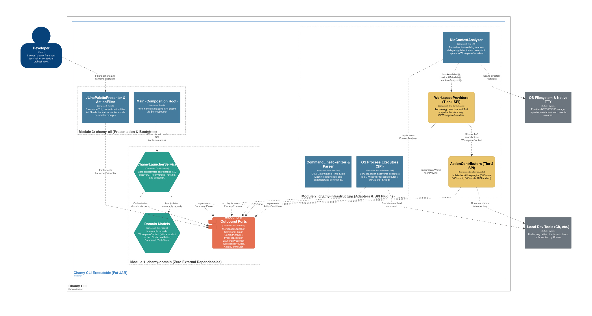

# Chamy

Chamy is a lightweight, context-aware workspace orchestrator and one-shot command palette for the terminal, engineered in Java 17+.

Rather than attempting to replace the host shell (`PowerShell`, `cmd.exe`, `bash`) and reimplement native shell internals, Chamy acts as a contextual intelligence layer invoked directly from the developer's existing terminal. It inspects the active workspace in milliseconds, surfaces workflows relevant to the live repository state, synthesizes parameterized commands in real time as the user types, delegates execution to the underlying OS, and exits cleanly.

---

## Core Capabilities (Milestone 1)

- **Two-Phase Dynamic Suggestion Pipeline:**
    - **T=0 State Introspection:** Scans the workspace once on startup and caches an immutable state snapshot in memory (working tree status via `git status --porcelain`, local/packed branches, worktrees, unborn repository detection). Irrelevant actions (such as `git log` or `git reset` on an empty repository) are automatically suppressed.
    - **T>0 Reactive Synthesis:** Evaluates user keystrokes purely in RAM (< 1ms) against the cached snapshot to synthesize live intent-driven commands (e.g., typing `commit fix bug` synthesizes `git commit -m "fix bug"`; typing `checkout feat/auth` distinguishes between switching to an existing branch or creating a new one; typing `log 25` synthesizes `git log --oneline -n 25`).
    - **Universal Fallback:** Any unrecognized input remains executable via a low-priority raw command fallback.
- **Zero-Allocation Live Filtering:** Multi-term, case-insensitive filtering powered by `String.regionMatches` to eliminate heap string allocations per keystroke.
- **Deterministic FSM Lexical Parser:** Hand-written `O(N)` Finite State Machine tokenizer supporting nested single/double quotes, backslash escapes, and empty quoted arguments without regex backtracking.
- **Ascendant Tree-Walking Scanner:** Resolves the workspace root automatically when invoked from deeply nested subdirectories or monorepo modules.
- **Native Win32 Signal Resilience:** Interfaces directly with `Kernel32.dll` via JNA (`SetConsoleCtrlHandler`) to terminate child process trees cleanly on `Ctrl+C` while applying quote-aware `< nul` isolation strictly to MS-DOS batch scripts.

---

## Architecture & Design Principles

Chamy is built around two non-negotiable architectural pillars: **Compiler-Enforced Hexagonal Architecture** and **100% Open/Closed Principle (OCP) Extensibility**.

### 1. Compiler-Enforced 3-Module Hexagonal Structure

In single-module repositories, Clean Architecture relies solely on developer discipline. Chamy enforces Hexagonal boundaries physically through a **Maven Multi-Module Reactor**:

```text
chamy-parent (pom)
 ├── chamy-domain           [Core Hexagon] Pure Java 17. ZERO external runtime dependencies.
 ├── chamy-infrastructure   [Adapters & SPI] Depends on chamy-domain + JNA. No UI coupling.
 └── chamy-cli              [Presentation]   Depends on domain + infrastructure + JLine.
```

- **`chamy-domain`:** Houses immutable domain `record`s, inbound/outbound ports, and the `ChamyLauncherService` orchestrator. It cannot import JLine, JNA, or OS-specific APIs—any boundary violation fails at compile time.
- **Type-Safe Heterogeneous Snapshot Cache:** `WorkspaceContext` encapsulates a `Map<Class<?>, Object>` container (Effective Java, Item 33), enabling infrastructure providers to share immutable T=0 snapshots with contributors in O(1) without leaking technology-specific types into the domain.

### 2. Three-SPI Architecture (100% Open/Closed Principle)

Every major axis of variation is decoupled behind a Java `ServiceLoader` Service Provider Interface (SPI), eliminating monolithic `switch/case` routers and hardcoded factories:

1. **`WorkspaceProvider` (Tier-1 SPI):** Detects a technology stack (e.g., `.git` directory or worktree pointer), extracts prompt metadata, and captures an immutable T=0 snapshot.
2. **`ActionContributor` (Tier-2 SPI):** Granular, isolated workflow units (e.g., `GitStatusContributor`, `GitCommitContributor`, `GitBranchContributor`, `GitStandardContributor`). Each feature lives in its own independent class.
3. **`ProcessExecutor` (OS SPI):** Declares host OS compatibility via `supports(String osName)`. Adding Linux/macOS support requires zero modifications to existing factories or domain services.

### 3. C4 Component Diagram (Hexagonal & SPI Topology)


<details>
<summary>Structurizr DSL Specification (C4 Levels 1, 2, and 3)</summary>

```structurizr
workspace "Chamy Architecture" "3-Module Hexagonal Architecture & 100% OCP SPI Engine" {

    model {
        developer = person "Developer" "Invokes 'chamy' from host terminal for contextual orchestration." "User"
        osFilesystem = softwareSystem "OS Filesystem & Native TTY" "Provides NTFS/POSIX storage, repository metadata, and console streams." "External"
        externalCliTools = softwareSystem "Local Dev Tools (Git, etc.)" "Underlying native binaries and batch tools invoked by Chamy." "External"

        chamy = softwareSystem "Chamy CLI" "One-Shot Contextual Command Palette & Workspace Orchestrator." {
            cliExecutable = container "Chamy CLI Executable (Fat-JAR)" "Self-contained Java 17+ executable packaging the 3 decoupled Hexagonal Maven modules." "Java 17 / Maven Shade" {

                group "Module 1: chamy-domain (Zero External Dependencies)" {
                    launcherService = component "ChamyLauncherService" "Core orchestrator coordinating T=0 discovery, T>0 synthesis, ranking, and execution." "Domain Service" "Core"
                    domainModels = component "Domain Models" "Immutable records: WorkspaceContext (with snapshot cache), ContextualAction, Command, TechStack." "Java Records" "Core"
                    ports = component "Inbound & Outbound Ports" "WorkspaceLauncher, CommandParser, ContextAnalyzer, ProcessExecutor, LauncherPresenter, WorkspaceProvider, ActionContributor." "Java Interfaces" "Port"
                }

                group "Module 2: chamy-infrastructure (Adapters & SPI Plugins)" {
                    nioScanner = component "NioContextAnalyzer" "Ascendant tree-walking scanner delegating detection and snapshot capture to WorkspaceProviders." "Java NIO" "Adapter"
                    fsmParser = component "CommandLineTokenizer & Parser" "O(N) Deterministic Finite State Machine parsing raw and parameterized commands." "Pure Java FSM" "Adapter"
                    osProcessEngine = component "OS Process Executors (SPI)" "ServiceLoader-discovered executors (e.g., WindowsProcessExecutor + Win32 JNA Shield)." "ProcessBuilder & JNA" "Adapter"
                    techProviders = component "WorkspaceProviders (Tier-1 SPI)" "Technology detectors and T=0 snapshot builders (e.g., GitWorkspaceProvider)." "Java ServiceLoader" "Plugin"
                    actionContributors = component "ActionContributors (Tier-2 SPI)" "Isolated workflow plugins (GitStatus, GitCommit, GitBranch, GitStandard)." "Java ServiceLoader" "Plugin"
                }

                group "Module 3: chamy-cli (Presentation & Bootstrap)" {
                    tuiPresenter = component "JLinePalettePresenter & ActionFilter" "Raw-mode TUI, zero-allocation filter, ANSI-safe truncation, cooked-mode parameter prompts." "JLine 3" "Adapter"
                    compositionRoot = component "Main (Composition Root)" "Pure manual DI loading SPI plugins via ServiceLoader." "Pure DI" "Adapter"
                }
            }
        }

        developer -> chamy "Triggers command palette and executes workflows"
        chamy -> osFilesystem "Traverses parent directories and controls TTY"
        chamy -> externalCliTools "Inspects status and executes selected commands"

        developer -> cliExecutable "Executes via 'java -jar'"
        cliExecutable -> osFilesystem "Performs NIO scans and TTY raw I/O"
        cliExecutable -> externalCliTools "Spawns child OS processes"

        developer -> tuiPresenter "Filters actions and confirms execution"
        compositionRoot -> launcherService "Wires domain and SPI implementations"
        tuiPresenter -> ports "Implements LauncherPresenter"
        launcherService -> ports "Orchestrates domain via ports"
        launcherService -> domainModels "Manipulates immutable records"
        nioScanner -> ports "Implements ContextAnalyzer"
        fsmParser -> ports "Implements CommandParser"
        osProcessEngine -> ports "Implements ProcessExecutor"
        techProviders -> ports "Implements WorkspaceProvider"
        actionContributors -> ports "Implements ActionContributor"
        nioScanner -> techProviders "Invokes detect(), extractMetadata(), captureSnapshot()"
        techProviders -> actionContributors "Shares T=0 snapshot via WorkspaceContext"
        nioScanner -> osFilesystem "Scans directory hierarchy"
        actionContributors -> externalCliTools "Runs fast status introspection"
        osProcessEngine -> externalCliTools "Executes resolved command"
    }

    views {
        systemContext chamy "Level1_SystemContext" {
            include *
            autoLayout tb
        }
        container chamy "Level2_Containers" {
            include *
            autoLayout tb
        }
        component cliExecutable "Level3_Components" {
            include *
            autoLayout tb
        }
        styles {
            element "Person" {
                shape Person
                background #08427B
                color #FFFFFF
            }
            element "External" {
                background #6C757D
                color #FFFFFF
            }
            element "Container" {
                background #438DD5
                color #FFFFFF
            }
            element "Core" {
                shape Hexagon
                background #2A9D8F
                color #FFFFFF
            }
            element "Port" {
                shape Component
                background #E76F51
                color #FFFFFF
            }
            element "Adapter" {
                shape Box
                background #457B9D
                color #FFFFFF
            }
            element "Plugin" {
                shape RoundedBox
                background #E9C46A
                color #000000
            }
        }
    }
}
```

</details>

---

## Extensibility Guide

Because Chamy adheres strictly to the Open/Closed Principle, extending the platform requires zero modifications to `chamy-domain`, `chamy-cli`, or existing plugins:

1. **Adding a New Git Workflow (e.g., `GitStashContributor`):**
    - Implement `ActionContributor` in `chamy-infrastructure`.
    - Read the cached `GitWorkspaceSnapshot` (or check `.git/refs/stash`).
    - Register the fully qualified class name in `META-INF/services/io.github.hichambenhsine.chamy.domain.port.outbound.ActionContributor`.
2. **Adding a New Technology Stack (e.g., Maven, Node.js, Docker):**
    - Implement `WorkspaceProvider` (detection + T=0 snapshot capture) and corresponding `ActionContributor`s.
    - Register both in `META-INF/services/`.
3. **Adding a New Operating System (e.g., Linux / macOS):**
    - Implement `ProcessExecutor` (`supports(osName)` returning true for `linux`/`mac`) and register it in `META-INF/services/io.github.hichambenhsine.chamy.domain.port.outbound.ProcessExecutor`.
4. **Adding a Desktop GUI (e.g., JavaFX):**
    - Create a new Maven module `chamy-gui` depending on `chamy-domain` and `chamy-infrastructure`.
    - Implement `LauncherPresenter` using JavaFX and reuse 100% of the domain and infrastructure layers untouched.

---

## Build & Usage

### Prerequisites
- **Java:** JDK 17 or higher
- **Maven:** 3.8+
- **OS:** Windows 10/11 (Milestone 1 target)
- **Tools:** `git` available on system `PATH`

### Build & Run Tests
From the repository root:
```cmd
mvn clean package
```
This runs all isolated unit tests across `chamy-domain` and `chamy-infrastructure` and builds the shaded executable Fat-JAR in `chamy-cli/target/chamy-cli-1.0.0.jar` (merging all SPI descriptors via `ServicesResourceTransformer`).

### Run Chamy
Navigate to any Git workspace in your terminal and execute:
```cmd
java -jar path\to\chamy-cli\target\chamy-cli-1.0.0.jar
```
*(Optionally create a `chamy.bat` wrapper in your `PATH` to invoke it simply via `chamy` from any folder).*

### Controls
- **Type:** Filter actions and trigger T>0 reactive synthesis in real time.
- **Up / Down Arrows:** Navigate the sliding viewport.
- **Enter:** Execute the selected action (prompts for parameters if required).
- **Esc / Ctrl+C / Ctrl+D:** Cancel and return cleanly to the host terminal.

---

## Roadmap

- **Milestone 1 (Current — v1.0.0-rc.1):** Compiler-enforced 3-module Hexagonal Architecture, 3-SPI 100% OCP engine, two-phase dynamic Git intelligence, Win32 JNA signal shielding, and JLine 3 interactive palette.
- **Milestone 2 (Ecosystem & Smart Ranking):** Add `GitStashContributor`, `MavenWorkspaceProvider`, `NodeWorkspaceProvider` (zero-dependency `package.json` parser), `DockerWorkspaceProvider`, fuzzy scoring, and per-workspace command history persistence.
- **Milestone 3 (Cross-Platform & Native Image):** Add `PosixProcessExecutor` (Linux/macOS), CI/CD build matrix (GitHub Actions), and GraalVM Native Image AOT compilation (< 20ms cold start).
- **Milestone 4 (Desktop GUI):** Introduce `chamy-gui` (JavaFX Spotlight-style overlay) reusing `chamy-domain` and `chamy-infrastructure` unmodified.

---

## License

This project is licensed under the **Apache License 2.0**. See the [LICENSE](LICENSE) file for details.